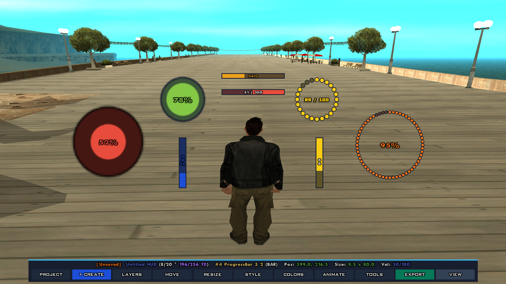

# Progress Bar Plus

[](https://github.com/Walter-Correa/Progress-Bar-Plus/releases)
[](https://opensource.org/licenses/MPL-2.0)
[](https://open.mp)

**Progress Bar Plus** is a high-performance, modern, flicker-free progress bar and visual gauge library engineered specifically for **San Andreas Multiplayer (SA-MP)** and **open.mp**.

It empowers Pawn developers to build fully customizable, hardware-accelerated HUD meters: **Linear Rectangular Bars**, **Segmented Radial Ring Odometers**, and **Concentric Circular Gauges**, complete with **Fluid Value Interpolation (Lerp)**, **Dynamic Multi-Stop Color Gradients**, **Intelligent Auto-Scaling HUD Text Labels**, **Cyclic Auto-Fill Animations**, and **Multi-Phase Blinking Alerts**—all operating with zero external dependencies and guaranteed $16:9$ widescreen pixel-perfect border correction.

> [!NOTE]
> This project is conceptually inspired by [@Southclaws](https://github.com/Southclaws)'s [progress2](https://github.com/Southclaws/progress2). It has been completely rebuilt from the ground up as a standalone, modern visual suite, introducing hardware-accelerated sprite rendering (`LD_SPAC:white` and `LD_BEAT:chit`), $16:9$ widescreen aspect-ratio border compensation, zero-flicker TextDraw recycling, open.mp native repositioning, smart bandwidth delta caching, and advanced animated states.

---

<p align="center">
  
</p>

---

## Comparison: progress2 vs. Progress Bar Plus

| Feature / Capability | progress2 (Southclaws) | Progress Bar Plus |
| :--- | :--- | :--- |
| **Rendering Primitive** | Text box padding using character `"_"` (`PlayerTextDrawUseBox`) | ✅ Hardware-accelerated native sprites (`LD_SPAC:white` & `LD_BEAT:chit`) |
| **Widescreen ($16:9$) Geometry** | Uncompensated coordinate offsets (borders appear thicker horizontally on $16:9$) | ✅ Exact $1.25\times$ vertical multiplier (`PB_BORDER_Y_RATIO`), uniform physical pixel thickness |
| **Supported Visual Styles** | 1 style (linear horizontal/vertical rectangular bar) | ✅ 3 styles (`PB_STYLE_BAR`, `PB_STYLE_RING` segmented radial odometer, `PB_STYLE_CIRCLE` concentric gauge) |
| **Standard SA-MP Value Updates** | Destroys & recreates textdraw on every update when `PlayerTextDrawSetPos` is unavailable | ✅ Zero-flicker dynamic sizing via `PlayerTextDrawTextSize`; never destroys textdraw on updates |
| **Zero-Value Z-Order Preservation** | Destroys textdraw on $0.0$; subsequent recreate re-renders bar on top of newer HUD layers | ✅ Hides element (`PlayerTextDrawHide`) on $0.0$; strictly preserves creation z-order |
| **External Dependencies** | Requires `YSI-Includes` (`y_iterate`) and `sampctl` toolchains in modern versions | ✅ Completely standalone and zero-dependency (only standard `<a_samp>` or `<open.mp>`) |
| **Fluid Value Interpolation (Lerp)** | ❌ None (requires external gamemode timers, step loops, and tracking variables) | ✅ Built-in quadratic ease-out interpolation (`InterpolatePlayerProgressBarValue`) |
| **Dynamic Color Gradients** | ❌ None (requires manual gamemode color math) | ✅ Built-in multi-stop color blending (`SetPlayerProgressBarGradient`) |
| **Visual HUD Text Labels** | ❌ None (requires external TextDraws manually attached to coordinates) | ✅ Built-in high-contrast HUD labels with token formatting, auto-scaling, and vertical stacking |
| **Dynamic Auto-Fill Animations** | ❌ None (requires external gamemode timers and state machines) | ✅ Built-in cyclic auto-fill engine (`AutoFillPlayerProgressBar`) preserving base progress |
| **Pulsing & Critical Alerts** | ❌ None (requires manual gamemode timer and color toggling logic) | ✅ Built-in multi-phase blinking engine (`BlinkPlayerProgressBar`) with independent colors |
| **Multi-Element Network Caching** | Not applicable (only supports basic 3-textdraw rectangular bars) | ✅ Per-segment delta cache (`PB_TDColour`), updating only modified dots to prevent packet flooding |
| **Tagging & Type Safety** | Requires strict `PlayerBar:` tag (produces tag mismatch warnings if handled as raw integer) | ✅ Standard integer IDs with backward compatibility tag/direction macros (zero compiler warnings) |
| **In-Game Visual Editor** | Basic single-bar scripts (`editor-pottus.pwn` / `editor-emmet.pwn`), export-only | ✅ Full **Progress Bar Plus - Editor** with clickable 11-button Dock, 20-layer Z-order stack, `.pbp` projects, `.pbt` templates, Pawn code importer, 3-format exporter & Undo |

---

## Documentation Hub

Comprehensive, modular guides and technical references are available in the [`docs/`](docs/) directory:

| Guide | Description |
| :--- | :--- |
| **[📖 Getting Started](docs/getting-started.md)** | Step-by-step setup, zero-dependency installation, and drop-in migration from `progress2`. |
| **[📐 Bar Styles & Geometry](docs/bar-styles.md)** | Linear bars, radial ring odometers, circular gauges, and $16:9$ widescreen border compensation. |
| **[⚡ Animations & Visual FX](docs/animations-and-fx.md)** | Smooth lerp (quadratic ease-out), multi-stop gradients, cyclic auto-fill, and blinking alerts. |
| **[🏷️ HUD Value & Text Labels](docs/text-labels.md)** | Intelligent auto-scaling, adaptive vertical text stacking (`~n~`), and dynamic color tracking. |
| **[🎨 In-Game Visual Editor](docs/in-game-editor.md)** | Interactive 11-tool dock, real-time keyboard transforms, multi-layer workspace, HUD anchors. |
| **[📚 Complete API Reference](docs/api-reference.md)** | Exhaustive technical dictionary with all 62 functions, parameters, return types, and constants. |

---

## Quick Start & Installation

### 1. File Placement

Copy `ProgressBar.inc` into your server's include directory:
* **SA-MP / Pawno:** `pawno/include/ProgressBar.inc`
* **open.mp / Qawno:** `qawno/include/ProgressBar.inc`

### 2. Include in Your Script

```pawn
#include <open.mp> // or <a_samp>
#include <ProgressBar>
```

> [!TIP]
> **Performance Tip (Include Order):** If your script uses TextDraw hooking libraries (such as `TextDrawFX`), place `#include <ProgressBar>` **before** them so that high-frequency progress bar updates bind directly to raw native functions and bypass third-party hook loops.

### 3. Basic Example

Create a modern, auto-scaling health meter with dynamic gradient color tracking in just a few lines:

```pawn
new PlayerBar:gPlayerHealthBar[MAX_PLAYERS];

public OnPlayerSpawn(playerid)
{
    // Create a 60x10 health bar anchored near the radar
    gPlayerHealthBar[playerid] = CreatePlayerProgressBar(
        playerid,
        548.0, 65.0, 60.5, 9.5,
        0x2ECC71FF, 100.0,
        PB_DIR_RIGHT, 1.25
    );

    // Enable dynamic 3-stop health gradient (Green -> Amber -> Red)
    SetPlayerProgressBarGradient(playerid, gPlayerHealthBar[playerid], true);

    // Attach high-contrast HUD text label tracking the bar's live color
    SetPlayerProgressBarLabel(playerid, gPlayerHealthBar[playerid], true, "{PERCENT}%", 0);

    // Display on screen
    ShowPlayerProgressBar(playerid, gPlayerHealthBar[playerid]);
    return 1;
}

public OnPlayerTakeDamage(playerid, issuerid, Float:amount, weaponid, bodypart)
{
    new Float:hp;
    GetPlayerHealth(playerid, hp);
    
    // Smoothly animate the bar to the new health value over 400ms
    InterpolatePlayerProgressBarValue(playerid, gPlayerHealthBar[playerid], hp, 400);
    return 1;
}
```

> [!TIP]
> Need to migrate an existing gamemode from `progress2`? Read the **[Migration Guide in docs/getting-started.md](docs/getting-started.md#migrating-from-progress2)** for instant 1:1 drop-in compatibility.

---

## In-Game Visual HUD Editor

**Progress Bar Plus** includes a full-featured in-game visual designer filterscript located in `Progress Bar Plus - Editor/`. Built with **Pawn.CMD** and an optimized 10-slot Session Pool architecture, it works out-of-the-box on both **SA-MP** and **open.mp**.

```
[ Style ] [ Color ] [ Transform ] [ Animate ] [ Align ] [ Duplicate ] [ Delete ] [ + Layer ] [ Save ] [ Export ] [ Close ]
```

### Highlights
* **Clickable 11-Button Dock:** Real-time HUD telemetry, grid snapping, and full-screen preview.
* **Keyboard Transform Engine:** Fluid 35ms positioning via `W/A/S/D` and Arrow keys with `SHIFT`/`CTRL` fast and `ALT` precision speed modifiers.
* **Multi-Layer Stacking:** Up to 20 bar layers per project with Z-order sorting and 1-step snapshot Undo.
* **Anti-Kick Rate Limiting:** Density-aware rebuild throttling and key-release auto-flush prevent `ackslimit` packet flooding even with 60-segment radial gauges.
* **Universal Exporter:** Generates ready-to-paste Pawn code (`.pwn`, `.inc`), project files (`.pbp`), and reusable layer templates (`.pbt`).

Type `/pbe` in-game to launch the editor.

> [!TIP]
> For the complete manual, keybinding tables, and session management, see **[docs/in-game-editor.md](docs/in-game-editor.md)**.

---

## Complete API Reference

All 62 functions, macros, style enumerations, and compile-time constants are exhaustively documented with signature parameters, return values, and code snippets in **[`docs/api-reference.md`](docs/api-reference.md)**:

* **[Lifecycle & Creation](docs/api-reference.md#1-lifecycle--creation):** `CreatePlayerProgressBar`, `DestroyPlayerProgressBar`, `ResetPlayerProgressBar`, `ShowPlayerProgressBar`, `HidePlayerProgressBar`...
* **[Value & Range Control](docs/api-reference.md#2-value--range-control):** `SetPlayerProgressBarValue`, `SetPlayerProgressBarRange`, `SetPlayerProgressBarMinValue`, `SetPlayerProgressBarMaxValue`...
* **[Position, Dimensions & Borders](docs/api-reference.md#3-position-dimensions--borders):** `SetPlayerProgressBarPos`, `SetPlayerProgressBarSize`, `SetPlayerProgressBarBorder`...
* **[Colors & Dynamic Gradients](docs/api-reference.md#4-colors--dynamic-gradients):** `SetPlayerProgressBarColour`, `SetPlayerProgressBarGradient`, `SetPlayerProgressBarGradientInverted`...
* **[Animations & Visual FX](docs/api-reference.md#5-animations--visual-fx):** `InterpolatePlayerProgressBarValue`, `AutoFillPlayerProgressBar`, `BlinkPlayerProgressBar`...
* **[HUD Value & Text Labels](docs/api-reference.md#6-hud-value--text-labels):** `SetPlayerProgressBarLabel`, `SetPlayerProgressBarLabelAutoScale`, `SetPlayerProgressBarLabelFollowColour`...
* **[Styles, Segments & Rings](docs/api-reference.md#7-styles-segments--radial-rings):** `SetPlayerProgressBarStyle`, `SetPlayerProgressBarSegments`, `SetPlayerProgressBarRingScale`...
* **[Constants & Enums](docs/api-reference.md#8-constants--enumerations):** `PB_STYLE_*`, `PB_DIR_*`, `PB_GRAD_*`, `PROGRESSBAR_VERSION_*`...
* **[Compile-Time Defines](docs/api-reference.md#9-compile-time-configuration-defines):** `PB_MAX_BARS`, `PB_MAX_TDS`, `PB_TICK_RATE`, `PB_BORDER_Y_RATIO`...

---

## Version History

<details>
<summary>Show the version history</summary>

### 2.2.0 — 03/11/2026
* **Intelligent Auto-Adaptive Text Stacking:**
  * Auto-adaptive label layout (`PB_FormatLabel` / `PB_IsLabelVertical`): automatically evaluates whether label text fits horizontally inside the bar's inner width. When narrow vertical bars cannot accommodate horizontal text, characters automatically stack vertically using `~n~` linebreaks while preserving embedded color tags (`{RRGGBB}`) and geometric center alignment.
  * Wide vertical bars dynamically maintain standard horizontal text layout without unnecessary stacking.
* **Dynamic Gradient Color Label Tracking:**
  * Label text can now dynamically inherit and synchronize with the bar's active fill color (`followColour = true`).
  * Injects dynamic `{%06x}` native SA-MP color tags, keeping HUD text label colors continuously synchronized across static colors, dynamic multi-stop gradients (`SetPlayerProgressBarGradient`), auto-fill previews, and lerp transitions.
* **Anti-Kick Rate Limiting & Network Protection:**
  * Fixed `client exceeded 'ackslimit'` kicks when moving or resizing high-density radial rings (45+ segments) by implementing density-aware rebuild throttling (200ms for $\ge 45$ segs, 120ms for $\ge 30$, 70ms for $<30$), continuous coordinate accumulation, and an immediate key-release auto-flush engine (`EP_RingPendingRebuild`).
  * Expanded radial ring segment scale multiplier bounds: minimum lowered to `0.10` (range: $0.10$ to $3.00$).
* **Dynamic Direction Change Fix:**
  * `SetPlayerProgressBarDirection` now completely re-renders and realigns progress fill sprites and text labels, allowing seamless live direction switching (`PB_DIR_RIGHT`, `PB_DIR_LEFT`, `PB_DIR_UP`, `PB_DIR_DOWN`) without visual offset distortion.
* **Standardized Include Versioning System:**
  * Introduced standard macro definitions in `ProgressBar.inc`: `PROGRESSBAR_VERSION_MAJOR`, `PROGRESSBAR_VERSION_MINOR`, `PROGRESSBAR_VERSION_PATCH`, and `PROGRESSBAR_VERSION_STRING`.
  * Updated GitHub Actions CI/CD workflows (`build.yml` and `release.yml`) to automatically parse and validate version macros from `ProgressBar.inc`.
* **Progress Bar Plus - Editor v2.2.0 Upgrades:**
  * Streamlined label orientation UI (fully automated auto-adaptive text positioning).
  * Live gradient color synchronization in the editor preview.
  * Segment scale range text updated to `0.10 - 3.00`.
* **Comprehensive Documentation Suite (`docs/`):**
  * Created dedicated documentation suite with 7 modular guides covering setup, geometry, animations, labels, editor manual, and exhaustive API reference.

### 2.1.0 — 02/11/2026
* **Smooth Value Interpolation (`InterpolatePlayerProgressBarValue`):**
  * Added built-in fluid value transition engine with quadratic ease-out curves and 30 FPS timer ticks (`PB_TICK_RATE = 33ms`).
  * Added `StopPlayerProgressBarInterpolation` and `IsPlayerProgressBarInterpolating` for complete runtime control.
  * Implemented mutual exclusion: activating lerp automatically halts auto-fill, and activating auto-fill automatically halts lerp.
* **Dynamic Multi-Stop Color Gradients (`SetPlayerProgressBarGradient`):**
  * Added dynamic color interpolation based on current bar fill ratio (Empty -> Midpoint -> Full, defaulting to Red -> Amber -> Green).
  * Added bidirectional gradient direction and polarity control (`SetPlayerProgressBarGradientInverted` / `SetPlayerProgressBarGradientDirection`) supporting Standard (Health: Red -> Green) and Inverted (Heat/Threat/Temperature: Green -> Red) progression modes.
  * Implemented real-time gradient synchronization with cyclic auto-fill preview animations across all bar styles.
  * Added `StopPlayerProgressBarGradient` and `IsPlayerProgressBarGradientEnabled`.
* **Intelligent Auto-Scaling HUD Text Labels (`SetPlayerProgressBarLabel`):**
  * Built-in high-contrast HUD text label with dynamic template token formatting (`{PERCENT}`, `{VALUE}`, `{MAX}`, `{MIN}`).
  * Added `SetPlayerProgressBarLabelAutoScale`: mathematically bounds font scale within the bar's inner dimensions so text never overflows borders across all resizes and moves.
* **Custom Min-Value Range (`SetPlayerProgressBarMinValue`, `SetPlayerProgressBarRange`):**
  * Added support for custom minimum thresholds with mathematical fill normalization (`part = (val - min) / (max - min)`), ensuring zero visual distortion.
* **Progress Bar Plus - Editor v2.1.0:**
  * Integrated Text Label designer with font picker, live preview, offset adjustments, and auto-scale toggle.
  * Integrated Dynamic Health Gradient toggle and Direction / Polarity switcher in Color & Themes menu.
  * Integrated Min-Value configuration dialog in Animations & Values menu.
  * Full export generator updated for all v2.1.0 functions across Pawn script, project (`.pbp`), and template (`.pbt`) formats.
* **Drop-In Compatibility & Repository Enhancements:**
  * 100% backward-compatible drop-in replacement for v1.0.0 and `progress2` codebases.
  * Added `.gitignore` to keep runtime server logs (`log.txt`, `server_log.txt`, `omp-server.log`) out of version control.
  * Added automated GitHub Actions build and release workflows (`.github/workflows/build.yml` and `release.yml`).

### 2.0.0 — 01/11/2026
* Introduced **Progress Bar Plus - Editor** (`Progress Bar Plus - Editor/filterscripts/FS_ProgressBarEditor.pwn` & `gamemodes/GM_ProgressBarEditor.pwn`):
  * Complete in-game visual HUD editor built with `Pawn.CMD`, compatible out-of-the-box with SA-MP and open.mp, accompanied by a lightweight sandbox test gamemode.
  * Memory-optimized 10-slot concurrent Session Pool architecture with automatic in-memory **Project Lock** protection preventing concurrent overwrites across active editors.
  * Interactive 11-button Editor Dock (Bottom / Top / Minimized fullscreen preview) with live telemetry HUD, project save state indicator (`[Saved]` / `[Unsaved]`), and alignment crosshair/thirds grid.
  * Multi-bar workspace supporting up to 20 layers per project with Z-order reordering, cloning, renaming, visibility toggling, and 1-step snapshot Undo.
  * Real-time `35ms` transform engine supporting Keyboard (`W/A/S/D` & Arrows) with `SHIFT`/`CTRL` fast and `ALT` fine speed modifiers, grid snapping, and $16:9$ perfect circle aspect-ratio locking for rings and circles with precise 1:1 screen synchronization.
  * Interactive Live Value Scrubber allowing developers to visually test fill thresholds in real time using WASD / Arrow keys.
  * Color & Theme Designer featuring 28 modern curated palette swatches, direct hex RGBA/RGB `#HEX` entry, 5 opacity presets, automatic border shading, and cross-layer visual theme cloning.
  * Segmented Radial Ring Customizer with real-time segment count adjustment ($4$ to $60$) and independent dot scale multipliers.
  * Dynamic Auto-Fill preview designer and multi-phase blinking alert configurator with interval and duration tuning.
  * Project management system saving binary `.pbp` workspaces to `scriptfiles/ProgressBarPlus/projects/` with automatic directory self-healing.
  * Template preset library saving reusable layer templates (`.pbt`) to `scriptfiles/ProgressBarPlus/templates/`.
  * Interactive Pawn code importer parsing `CreatePlayerProgressBar` code directly into live editable layers.
  * Tri-format code exporter generating modular standalone includes (`.inc`), standalone test gamemodes (`.pwn`), or raw code snippets into `scriptfiles/ProgressBarPlus/exports/`.

### 1.0.0 — 01/11/2026
* Initial public release of **Progress Bar Plus**:
  * Pure sprite rendering engine utilizing native `LD_SPAC:white` (linear bars) and `LD_BEAT:chit` (segmented radial rings and expanding concentric circular gauges).
  * Built-in widescreen aspect-ratio border compensation (`PB_BORDER_Y_RATIO = 1.25`) guaranteeing uniform physical pixel thickness on $16:9$ monitors.
  * Dynamic in-place coordinate resizing (`PlayerTextDrawTextSize` and open.mp `PlayerTextDrawSetPos`) eliminating TextDraw destruction flickering.
  * Handle preservation and zero-value hiding (`PlayerTextDrawHide`) maintaining strict Z-index ordering.
  * Dynamic cyclic auto-fill animation engine (`AutoFillPlayerProgressBar`).
  * Multi-phase blinking alert system (`BlinkPlayerProgressBar`) with independent inner and border color overrides.
  * Per-segment delta network caching (`PB_TDColour`) preventing bandwidth packet flooding on high-frequency ring updates.
  * Zero external dependencies—fully compatible with standard SA-MP (`<a_samp>`) and open.mp (`<open.mp>`).

</details>

---

## Author & Credits

* [@Walter-Correa](https://github.com/Walter-Correa) - Concept and development of **Progress Bar Plus**, with the assistance of **Artificial Intelligence**.
* [@Southclaws](https://github.com/Southclaws), [@Toranks](https://github.com/Toranks), and [@Pottus](https://github.com/Pottus) - Foundational concepts and inspiration from legacy SA-MP progress bar libraries.

---

## License

This project is licensed under the **Mozilla Public License 2.0 (MPL-2.0)**. See the [LICENSE](LICENSE) file for complete legal terms.
