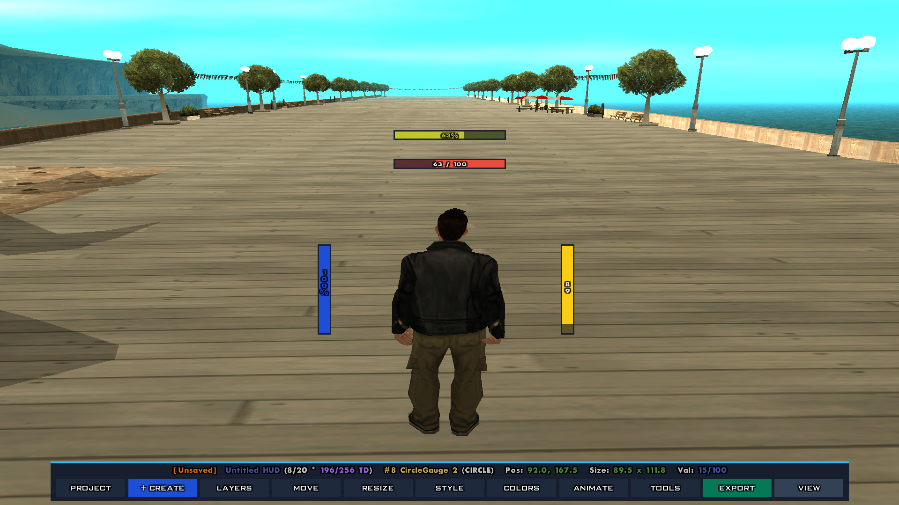
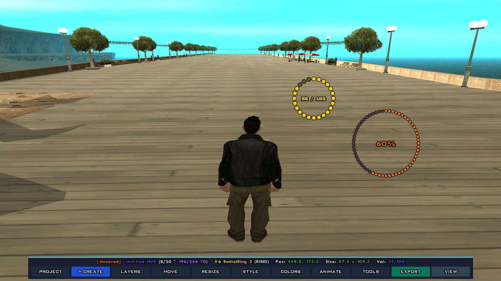
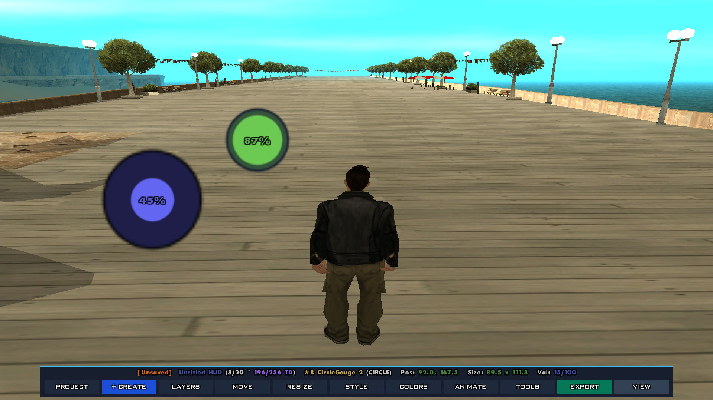

# Bar Styles & Geometry

Progress Bar Plus offers three visual rendering architectures: **Linear Rectangular Bars**, **Segmented Radial Ring Odometers**, and **Concentric Circular Gauges**. Every style features hardware sprite acceleration and automatic $16:9$ widescreen aspect-ratio compensation.

---

## 1. Linear Rectangular Bars (`PB_STYLE_BAR`)

<p align="center">
  
</p>

Linear rectangular bars are the classic HUD meters used for Health, Armour, Breath, Stamina, Weapon Reload, and Fuel.

```pawn
#define PB_STYLE_BAR (0)
```

### Flow Directions
Bars can progress in any of four cardinal directions:

| Direction Constant | Numeric Value | Description | Typical Use Case |
| :--- | :---: | :--- | :--- |
| `PB_DIR_RIGHT` | `0` | Fills from Left → Right (Default) | Standard horizontal HUD meters |
| `PB_DIR_LEFT` | `1` | Fills from Right → Left | Mirror/Opponent HUD meters |
| `PB_DIR_UP` | `2` | Fills from Bottom → Top | Vertical bars (Battery, Volume, Elevators) |
| `PB_DIR_DOWN` | `3` | Fills from Top → Bottom | Depletion / Gravity / Falling meters |

```pawn
SetPlayerProgressBarDirection(playerid, barid, PB_DIR_UP);
```

### 16:9 Widescreen Border Math ($1.25\times$)
In the GTA San Andreas textdraw coordinate engine:
* The virtual canvas is fixed at $640 \times 448$ pixels.
* On modern $16:9$ widescreen monitors, the vertical axis has non-square pixels relative to horizontal pixels. The pixel aspect ratio is calculated as:

$$\text{Ratio} = \frac{16 / 9}{640 / 448} = \frac{16 \times 448}{9 \times 640} = \frac{7168}{5760} \approx 1.25$$

Progress Bar Plus automatically compensates for this distortion using `PB_BORDER_Y_RATIO`:
```pawn
#define PB_BORDER_Y_RATIO (1.25)
```
When you set a border thickness of `1.25`, the horizontal border is $1.25$ px and the vertical border is scaled to $1.25 \times 1.25 \approx 1.56$ px. This guarantees that borders appear **pixel-perfect, uniform, and square** on widescreen screens.

### Border Options
* **`PB_BORDER_DEFAULT`:** $1.25$ pixels (standard crisp outline).
* **`PB_BORDER_NONE`:** $0.00$ pixels (completely borderless bar).
* **Custom thickness:** Set any value between $0.50$ and $5.00$ pixels via `SetPlayerProgressBarBorder`.
* **Custom border color:** Set individual border RGBA color (e.g., `0x000000FF` for pitch black, or `0x38BDF8FF` for neon blue).

---

## 2. Segmented Radial Ring Odometers (`PB_STYLE_RING`)

<p align="center">
  
</p>

Radial rings display progress as a circular array of anti-aliased dot sprites (`LD_BEAT:chit`), emulating modern sports-car tachometers, supercar boost gauges, and sci-fi shield odometers.

```pawn
#define PB_STYLE_RING (1)
```

### Segment Count Range ($4$ to $60$)
You can configure the ring density by choosing how many segments make up the circle:
* **Minimum Segments:** `4` (`PB_RING_MIN`)
* **Maximum Segments:** `60` (`PB_RING_MAX`)
* **Default Segments:** `24` (`PB_RING_SEGMENTS`)

```pawn
SetPlayerProgressBarSegments(playerid, barid, 36);
```

### Segment Scale Multiplier ($0.10$ to $3.00$)
The segment scale determines the relative thickness and overlap of each chit dot:
* **Scale Range:** $0.10$ (ultra-fine dots) to $3.00$ (thick, connected circular ring band).
* **Default:** `1.00` (`PB_RING_SEGMENT_SCALE`).

```pawn
SetPlayerProgressBarRingScale(playerid, barid, 1.25);
```

### Angular Geometry & Direction
Radial rings compute $360^\circ$ trigonometric coordinate steps:

$$\theta_i = -90^\circ + \left(\frac{360^\circ}{N}\right) \cdot i$$

* **Clockwise (`PB_DIR_RIGHT` / `PB_DIR_DOWN`):** Fills clockwise starting from the 12 o'clock position ($-90^\circ$).
* **Counter-Clockwise (`PB_DIR_LEFT` / `PB_DIR_UP`):** Fills counter-clockwise starting from the 12 o'clock position.

### High-Density Performance Architecture
On open.mp, Progress Bar Plus uses **in-place PlayerTextDraw repositioning** (`PlayerTextDrawSetPos` + `PlayerTextDrawTextSize`) and intelligent delta network caching. Even at $60$ segments ($120$ TextDraw parts), the network volume remains well under $1,500$ packets/sec, completely immune to `client exceeded 'ackslimit'` kicks.

---

## 3. Concentric Circular Gauges (`PB_STYLE_CIRCLE`)

<p align="center">
  
</p>

Circular gauges use a continuous inner sprite quad that dynamically expands and positions itself inside a circular boundary.

```pawn
#define PB_STYLE_CIRCLE (2)
```

Ideal for circular fuel dials, analog clock interfaces, and circular radar telemetry.

---

## 4. Code Examples

### Example A: Vertical Oxygen Tank Bar
```pawn
new PlayerBar:barOxygen = CreatePlayerProgressBar(
    playerid,
    610.0, 300.0,
    10.0, 75.0,        // Narrow and tall
    0x00E5FFFF,         // Cyan fill
    100.0,
    PB_DIR_UP,          // Fills from bottom to top
    1.25,               // Crisp border
    0x000000FF          // Black border
);
```

### Example B: 36-Segment Radial Tachometer Ring
```pawn
new PlayerBar:barRPM = CreatePlayerProgressBar(
    playerid,
    280.0, 180.0,
    80.0, 80.0,
    0xF59E0BFF,         // Amber fill
    8000.0,             // Max 8000 RPM
    PB_DIR_RIGHT,       // Clockwise
    1.25,
    0x000000FF,
    PB_STYLE_RING,      // Radial ring style
    36,                 // 36 segments
    1.15                // 1.15 scale factor
);
```

### Example C: Changing Style and Scale Dynamically
```pawn
// Convert an existing linear bar into a radial ring on the fly
SetPlayerProgressBarStyle(playerid, barid, PB_STYLE_RING, 30, 1.20);
```
